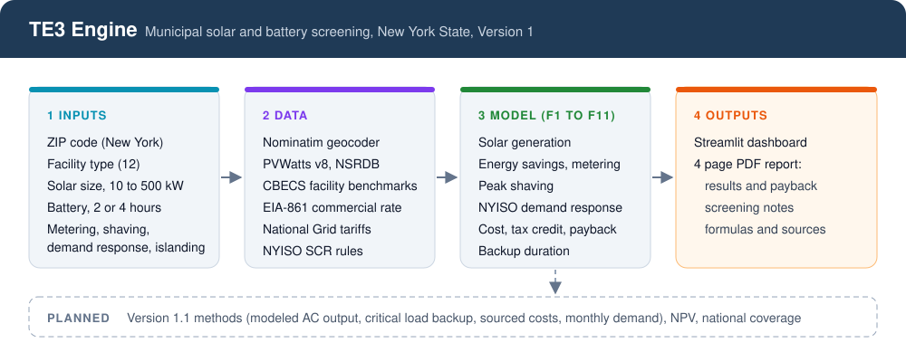

# TE3 Engine: Techno-Economic Evaluation Engine

[](https://doi.org/10.5281/zenodo.24239224) [](https://te3-engine.streamlit.app/)

TE3 Engine is a Streamlit screening tool for municipal solar photovoltaic (PV) and battery energy storage system (BESS) investments in New York State. From a ZIP code, a facility type and a solar array size, it estimates annual solar generation, the share of facility electricity use met by solar, annual savings by revenue stream, net capital cost, simple payback and, when selected, an indicative backup duration. It exports a four page pre-feasibility screening report as a PDF.

Results are screening estimates. They are intended to show whether a detailed study is warranted. They are not a design, an investment grade analysis, or tax or legal advice.

**Live app:** https://te3-engine.streamlit.app/ (no installation needed). If the app has been idle, it may take up to a minute to wake up.



## Scope of Version 1

- **Geography:** New York State ZIP codes only; ZIP codes in other states are rejected. National Grid (Niagara Mohawk) Upstate New York tariffs and its average commercial rate are applied to every New York ZIP code.
- **Facility types (12):** Municipal Office Building, Police Station, Fire Station, Public Library, Public School Facility, Community Center, Water Treatment Plant, Wastewater Treatment Plant, Public Works Facility, Smart Street Lighting System, Traffic Signal Network, Emergency Operations Center (EOC).
- **Facility loads:** benchmark archetypes defined in `facility_profiles.py`. Users do not enter their own load data in Version 1.
- **System size:** solar capacity from 10 to 500 kW in 10 kW steps. Battery power equals solar capacity; battery duration is 2 or 4 hours.

## What the model calculates

| Module | Basis |
|---|---|
| Solar generation | Annual solar resource from the PVWatts v8 API (NSRDB typical year data), with 14% system losses |
| Energy cost savings | On site solar use valued at the EIA-861 (2024) Niagara Mohawk average commercial rate, 10.43 cents per kWh |
| Net energy metering (optional) | Surplus generation credited at the average commercial rate; an upper estimate, since most new non-residential projects in New York receive Value Stack compensation |
| Battery peak shaving (optional) | Avoided delivery demand charge under National Grid SC-2 Demand or SC-3 Secondary (above the first 40 kW); not available on lighting tariffs, which have no demand charge |
| NYISO demand response (optional) | Battery capacity enrolled in the Special Case Resources (SCR) program at 20 dollars per kW-year, limited by a facility dispatch factor, the 4 hour SCR obligation and facility peak demand |
| Microgrid islanding (optional) | Indicative backup duration; requires battery storage and adds a 15% capital cost premium |
| Financials | Gross capital cost, 30% federal Investment Tax Credit, net capital cost and simple payback |

The formulas (F1 to F11), symbols and sources are printed in Section 4 of every PDF report and documented in the Technical Reference Manual.

## Tax credit timing

The model applies the 30% federal Investment Tax Credit (Section 48E) to every run. Under the 2025 federal tax law, a solar project that began construction after July 4, 2026 must be placed in service by December 31, 2027 to qualify. The app and the PDF report display this notice. The model does not test project dates; confirm eligibility with tax counsel.

## Data sources

- U.S. EIA, 2018 Commercial Buildings Energy Consumption Survey (CBECS), Tables B16, C22 and C14: floor area and electricity intensity by building type
- U.S. Department of Defense, UFC 3-501-03N: building load factors
- National Grid Upstate New York 2026 class load profiles: load factor bounds and street lighting operating hours
- EPRI (via ACEEE) and NYSERDA: water and wastewater treatment energy intensity
- U.S. EIA, Form EIA-861 (2024), Table 7: average commercial electricity rate
- National Grid Upstate New York Service Rates (PSC No. 220 and PSC No. 214): demand charges and tariff classes
- NYISO Special Case Resources program rules and 2026-27 capacity accreditation factors: demand response
- PVWatts v8 API with National Solar Radiation Database (NSRDB) data, National Laboratory of the Rockies (formerly NREL)
- GeoNames postal code data (https://www.geonames.org/, CC BY 4.0, retrieved 2026-11-18): ZIP code locations
- OpenStreetMap Nominatim: fallback for ZIP codes not in the GeoNames table

Full citations and links are in the working paper and the Technical Reference Manual.

## Installation

Requires Python 3.10 or newer.

```bash
git clone https://github.com/Olumide-Akindipe/te3-engine.git
cd te3-engine
python -m venv .venv
source .venv/Scripts/activate      # Windows (Git Bash)
# .venv\Scripts\Activate.ps1       # Windows (PowerShell)
# source .venv/bin/activate        # macOS or Linux
python -m pip install -r requirements.txt
```

## API key

The app needs a free API key from the National Laboratory of the Rockies developer network: https://developer.nlr.gov/signup/

**Local use:** copy `.env.example` to `.env` and add your key:

```
NREL_API_KEY=your_key_here
```

**Streamlit Community Cloud:** add `NREL_API_KEY` under the app's Settings, Secrets.

Never commit `.env`. It is listed in `.gitignore`. The app never displays the key, including in error messages.

## Privacy

TE3 does not store the information you enter. The ZIP code is sent to OpenStreetMap Nominatim to find its location, and the coordinates are sent to the PVWatts API to retrieve solar data. The app is hosted on Streamlit Community Cloud, which collects standard usage data under its own privacy policy.

## Security

To report a security issue, see `SECURITY.md`.

## Running the app

```bash
streamlit run app.py
```

## Running the tests

```bash
python -m pytest -q
```

The 12 automated tests mock the geocoder and solar resource calls, so no API key or network connection is needed.

## Limitations

- Facility loads are national benchmarks for each building type. They have not yet been compared with metered New York bills, so accuracy for an individual building is not established; an error of 30 to 40% is plausible. Confirm use with 12 months of utility bills before design.
- Capital costs are planning assumptions: 2,500 dollars per kW for solar; 600 dollars per kW for a 2 hour and 950 dollars per kW for a 4 hour battery; 15% islanding premium.
- Generation applies the 14% PVWatts default losses but not module temperature or inverter efficiency effects.
- Peak shaving uses one annual peak for all 12 months and is an upper estimate. Peak shaving and demand response revenues are added without checking that one battery can deliver both in the same hours.
- Backup duration divides battery energy by facility peak demand. It is an indicative estimate, not a critical load analysis.
- Battery degradation and replacement, operations and maintenance, interconnection, financing, rate escalation and net present value are not modeled.

## Planned work

Version 1.1: PVWatts modeled AC output (temperature and inverter effects), a critical load backup method, sourced capital cost benchmarks and monthly demand.

Later versions: net present value, coverage beyond New York State with utility specific rates, and machine learning load and solar yield forecasting.

## Documentation

- Working paper: *TE3 Engine: A Techno-Economic Screening Framework for Municipal Solar PV and Battery Storage, New York State Implementation (Version 1)*, Revision 2, November 2026
- Technical Reference Manual, Revision 2, November 2026: every parameter, formula, source and test

## Citation

Software:

Akindipe, S. O. (2026). *TE3 Engine: Techno-Economic Evaluation Engine* (Version 1.0) [Computer software]. Zenodo. https://doi.org/10.5281/zenodo.24239224

Working paper:

Akindipe, S. O. (2026). *TE3 Engine: A Techno-Economic Screening Framework for Municipal Solar PV and Battery Storage, New York State Implementation (Version 1).* Working Paper, Revision 2. Albany, NY.

The working paper DOI will be added when the paper is deposited.

## License

The software is released under the MIT License. See `LICENSE`.

The working paper, Technical Reference Manual and sample PDF reports are licensed under Creative Commons Attribution 4.0 International (CC BY 4.0): https://creativecommons.org/licenses/by/4.0/

## Author

Stephen Olumide Akindipe, Independent Researcher, Albany, NY, USA
ORCID: https://orcid.org/0000-0002-1846-9662